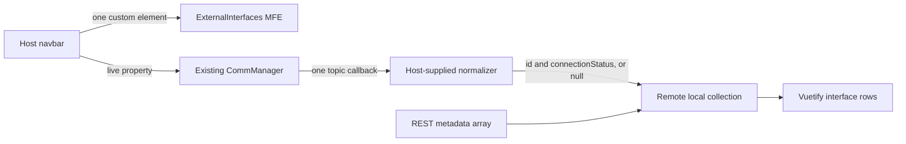

# Implementation and integration guide

## Confirmed architecture

The original request described N independently mounted interface remotes. The final
decision replaces that design with **one ExternalInterfaces collection MFE**.
The navbar renders it once. The remote fetches the collection and runs the loop
internally. The navbar is not a topic subscriber.



The normalizer is invoked by the remote's subscribed callback. The diagram's arrows
describe data flow, not an extra service or router. Nothing creates a connection.

## Boundary contracts

```ts
interface HostWebsocket {
  subscribe(topic: string, listener: (raw: unknown) => void): void;
  unsubscribe(topic: string): void;
}

type NormalizeMessage = (raw: unknown) => {
  id: number;                         // Safe integer
  connectionStatus: number | null;     // Finite number; null is valid data
} | null;
```

The normalizer is synchronous, returns a value, and does not mutate remote state.
It should return `null` for messages it intentionally ignores. `undefined`, a
Promise, a string ID, or a differently named status field is invalid. If the host
uses raw JSON strings, decode them in its normalizer; the remote makes no assumption
about raw envelopes. A bound method is needed if the normalizer itself uses `this`.

The remote validates the normalized output independently. A throwing normalizer or
invalid return value produces a diagnostic and leaves current state intact. The
host's WebSocket is passed by reference and called as `websocket.subscribe(...)`
and `websocket.unsubscribe(...)`, preserving prototype methods and private fields.

REST returns an array, without an `items` envelope:

```ts
Array<{
  id: number;
  connectionStatus: number | null;
  displayName: string;
  groupName: string | null;
  type?: unknown;
}>
```

Additional fields are preserved, and duplicate IDs are rejected. `type` is retained
as opaque metadata and does not affect rendering. Zod treats `unknown` as permitting
an absent value. IDs are numeric throughout; any string-to-number conversion belongs
in a client adapter, where it can be validated intentionally.

## Config

| Field | Default / meaning |
| --- | --- |
| `apiBaseUrl` | Required HTTP(S) URL or host-rooted path such as `/api` |
| `interfacesPath` | `/interfaces-x`; placeholder to replace in the internal repo |
| `topic` | `interface-communication-x` |
| `credentials` | `same-origin`; also accepts `include` or `omit` |
| `requestTimeoutMs` | 15000; independent of the host's federation loading timeout |
| `statusLabels` | `{}`; map stringified numeric codes or `"null"` to labels |
| `statusColors` | `{}`; map codes to Vuetify semantic colors |

Relative API paths resolve on the host page origin, not the origin serving the
remote JavaScript. `apiBaseUrl: '/api'` and `interfacesPath: '/interfaces-x'` produce
`/api/interfaces-x`. Absolute base paths retain their prefix.

No authentication policy was supplied. Standard `fetch` is used. Cross-origin cookie
authentication needs `credentials: 'include'` plus the server's actual cookie/CORS
configuration. Bearer-token or interceptor-dependent APIs require adapting
`src/api.ts` to the host's approved HTTP integration. Do not put credentials in
federation environment variables or JSON config. The endpoint correction was
explicitly deferred by the user.

## Federation wiring

The same public container name must appear in each place:

| Setting | Required value |
| --- | --- |
| Remote federation `name` | `ExternalInterfaces` |
| Host Vite `remotes` key | `ExternalInterfaces` |
| Registry federation `name` | `ExternalInterfaces` |
| Registry/host `entryGlobalName` | `ExternalInterfaces` |
| Import / `loadRemote` prefix | `ExternalInterfaces/register` |
| Expose key / registry `exposedModule` | `./register` |
| Custom element tag / `wrapperElementName` | `cust-external-interfaces` |
| Share scope | `default` |

The host application name (`HostVueVite` in examples) is independent of the remote
name. Keep the existing host name. The initial wording referred to a "Webpack
Remote Name"; this remote uses Vite, so apply that same invariant to Vite's
federation `name`. No Webpack build is required.

`filename: 'remoteEntry.js'` generates an ESM container. The additional
`varFilename: 'remoteEntry.var.js'` option generates the global wrapper required by
`type: 'var'`. The host environment variable must point to **remoteEntry.var.js**.
The wrapper dynamically imports the adjacent ESM entry; publish both files and all
referenced assets. Do not point a `var` registry at `remoteEntry.js` or assume that
the ESM entry creates `window.ExternalInterfaces`.

The exposed module registers the custom element as an import side effect and also
exports `registerExternalInterfaces`, `ExternalInterfacesElement`, and a default
constructor. `registerExternalInterfaces()` is idempotent. It does not replace a
previously registered constructor. Reload the page after deploying a new implementation
under the same custom-element tag; the browser registry cannot redefine that tag.

The installed private loader's export convention was not supplied. Verify whether
it imports and creates the tag (the implemented convention), calls a registration
function, or expects a different module shape. Adapt `src/register.ts` at this
boundary if needed; do not redesign data flow to solve a loader convention mismatch.

## Host integration sequence

1. Keep the existing global registration of `generic-module-federation-host` from
   `@gf/generic-module-federation-host` 1.0.1. The exact installer export was not
   verifiable here; use the host's existing working registration code.
2. Capture the existing manager and normalizer in `createMfeRegistry(...)`, using
   `examples/host/registry.ts`. Keep service references outside `defaultConfig`.
3. Use the existing `createRuntimeMfeRegistry(MfeRegistry, envResolver)` helper and
   existing provide/inject key. A runtime registry resolves configuration; it is
   not the same object as the build-time Vite `remotes` mapping.
4. Resolve `VITE_EXTERNAL_INTERFACES_ENTRY_URL` to the `var` entry URL in the registry
   and host federation configuration. If your registry already generates the host
   federation mapping, use that path instead of registering it twice.
5. Ensure the compiler's `isCustomElement` recognizes `cust-*` and registered wrapper
   names. Do not classify `generic-module-federation-host` as a custom element; it
   is the host's registered Vue component.
6. Render the generic host once in the navbar, with the definition for
   `ExternalInterfaces`, `loading-timeout-duration`, loading/error slots and the
   existing event bindings. See `Navbar.example.vue`.
7. Verify the property bridge. `toElementProps` must assign the three resulting
   values using JavaScript properties. Functions/objects must survive intact.
8. Check event forwarding using the internal host's real `eventMap` schema. Its
   shape was not supplied, so no speculative mapping object is included.

For a Vue bridge, use explicit property bindings if required:

```vue
<cust-external-interfaces
  :config.prop="serializedConfig"
  :websocket.prop="existingCommManager"
  :normalizeMessage.prop="normalizer"
/>
```

An equivalent DOM bridge can import/register first, create the tag, and use:

```ts
Object.assign(element, {
  config: JSON.stringify(serializableConfig),
  websocket: existingCommManager,
  normalizeMessage: normalizer,
});
parent.append(element);
```

This illustrates the assignment inside the generic host, not a reason to bypass
that host in production. The custom element also upgrades own properties assigned
before registration. Keep service objects out of deep reactive config containers;
use `markRaw` at the host boundary if the existing host would otherwise proxy the
manager. `markRaw` is only useful if applied before a reactive proxy is created.

## Lifecycle and state

- Validate all input before subscribing or fetching.
- Subscribe before awaiting the initial GET so early status changes are not lost.
- While loading, buffer the latest status by ID. Once metadata arrives, apply those
  buffered values over REST status values, including an explicit `null`.
- After load, update matching known IDs only. Unknown IDs do not synthesize rows.
- On unmount, unsubscribe exactly once, abort the fetch, clear pending updates,
  unmount Vue, and dispose the local Vuetify instance. Never close the host socket.
- A same-turn DOM move does not churn subscriptions. A later reconnection starts a
  fresh request and subscription.
- Changing config, WebSocket identity or normalizer identity restarts the collection.
  Assigning the same values does not restart it. Keep function/object identities
  stable when the host re-renders.
- `element.reload()` explicitly refreshes metadata and reestablishes the single
  subscription. It can be called after a relevant host reconnect event if your
  application requires a fresh snapshot.

Only one mounted collection may own a given manager/topic. No router, subscriber ID
change or new CommManager was added. If the existing manager rejects a duplicate
subscription, the remote shows an error and never unsubscribes the owner's topic.
Metadata failure releases the acquired subscription; Retry starts a new controller.

No server sequence numbers/timestamps were supplied. Ordering is local receive
order, with buffered live values preferred over initial metadata. Stronger ordering
across reconnects or stale server messages needs a server contract. Membership
changes require reload; status messages alone do not add/remove interfaces.

## Vuetify and navbar theme

The remote creates its own `createVuetify({ theme: false })` instance and installs it
into its Vue app. This supplies component injections without passing the host's
Vuetify object. It renders in light DOM under the navbar and uses inherited
`--v-theme-*` variables. Disabling remote theme generation avoids creating competing
global theme CSS and automatically follows host light/dark/custom theme changes.

Mount it beneath the host's active `.v-theme--...` ancestor. A standalone mount
without those variables needs a surrounding host theme, as the harness provides.
Do not wrap the remote in `VApp` solely to obtain a theme; a full-page application
layout is inappropriate inside a navbar. Shadow DOM would require a different CSS
and theme integration and is not enabled here.

Vue and Vuetify root package imports are configured as exact-version shared
singletons. Vuetify components are imported from `vuetify/components` and bundled
with this remote. Sharing the root key does not automatically promise that every
Vuetify subpath is shared. The root provider symbols in this version use
`Symbol.for`, and the same-version setup is exercised by the browser tests. If your
organization requires sharing component subpaths too, explicitly align those keys
and versions on both sides and rerun the harness. Do not add a catch-all share rule
without checking what the installed plugin emits.

## Events and two different readiness states

The private host owns federation `state-change` (`LOADING`/`READY`/`ERROR`), loading
slots, entry timeouts and retry of code loading. The remote emits native CustomEvents
with `bubbles: true`, `composed: true`, and an object in `event.detail`:

| Event | Detail |
| --- | --- |
| `mfe-event` | `{ type: 'external-interfaces:data-state', state: 'LOADING' | 'READY' | 'ERROR' }` |
| `mfe-event` | `{ type: 'external-interfaces:diagnostic', code, message }` |
| `componentClick` | `{ interfaceId, connectionStatus }` |
| `componentDoubleClick` | Same shape |
| `componentRightClick` | Same shape |

Federation READY means the code/element can be loaded. REST can still be loading or
fail afterward. The remote does not impersonate the host's loader state-change
event. The view is read-only, so it does not emit `update:config`. A double click
also naturally produces click events. The context menu is not suppressed.

## Deployment

Build with `MFE_PUBLIC_BASE` set to the absolute remote asset directory URL, including
its trailing slash. Copy `.env.example` to `.env.local` for local configuration or
provide the variable through CI. Publish the entire `dist` directory atomically.
It contains the var wrapper, ESM entry, JavaScript chunks, CSS and manifests.

Serve JavaScript with the proper MIME type and permit the host origin to fetch the
remote's ESM/CSS assets. Configure the host's actual CSP for its intended remote
asset origin. Ensure API routes and remote asset URLs have appropriate separate
server routing; a SPA fallback returning HTML for a missing JS chunk will fail.
Apply short/revalidated caching to entry files and immutable caching to hashed
assets. Keep old hashed chunks available across a rollout when old entries may be
cached. Source maps are enabled for troubleshooting; apply your deployment policy
to publication of maps.

Vite plugin 1.18.2 depends on federation runtime 2.8.0, whereas enhanced 2.6.0 brings
runtime 2.6.0. Both are pinned transitively in the lockfile. The harness checks their
observed interoperation for this implementation; that is not a universal guarantee
for every private loader/runtime plugin. Do not force a blanket package override
to one runtime version merely to make the dependency tree look uniform.
